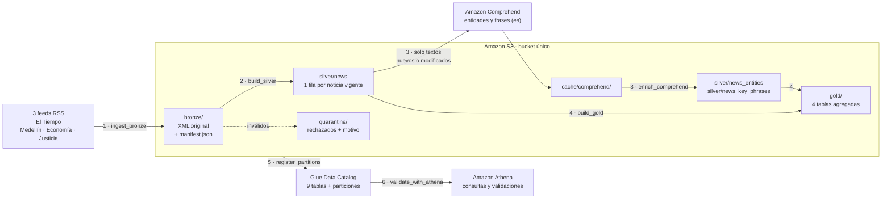
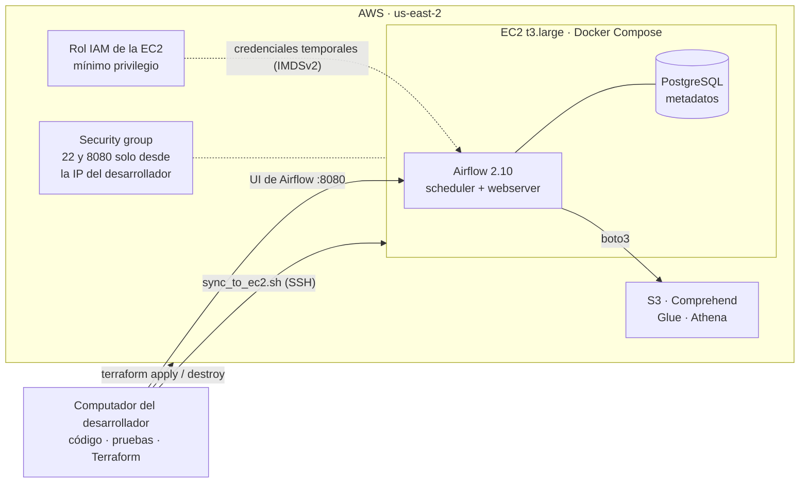
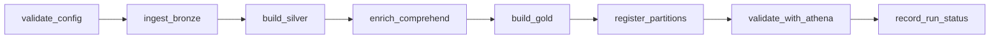

# Arquitectura del Data Lake

Pipeline de noticias RSS de **El Tiempo** en AWS (`us-east-2`), orquestado por Apache Airflow en una EC2.

## Diagrama 1 · Flujo de datos

Todo el flujo lo ejecuta **Airflow** (diagrama 2); los números son el orden de las tareas del DAG. El estado y los conteos de cada lote se guardan en `control/` del mismo bucket.

## Diagrama 2 · Despliegue

Imágenes estáticas de ambos diagramas: [`arquitectura_flujo.png`](arquitectura_flujo.png) y [`arquitectura_despliegue.png`](arquitectura_despliegue.png).

## Flujo del DAG `rss_datalake`

| # | Tarea | Lee | Escribe | Idempotencia |
|---|---|---|---|---|
| 1 | `validate_config` | `config/sources.yaml`, `.env` | `control/airflow_runs/` (run_id del lote) | El run_id se fija una vez por ejecución de Airflow |
| 2 | `ingest_bronze` | 3 feeds RSS (o nada si es reproceso) | `bronze/…/feed.xml`, `manifest.json`, `control/runs/…/bronze.json` | Si el `manifest.json` existe y es exitoso, la fuente no se vuelve a consultar |
| 3 | `build_silver` | Bronze del lote + Silver vigente | `silver/news/`, `quarantine/`, `control/batch_log/` | Merge determinista contra el conjunto vigente; solo reescribe particiones que cambian |
| 4 | `enrich_comprehend` | `silver/news/`, `cache/comprehend/` | `cache/`, `silver/news_entities/`, `silver/news_key_phrases/` | Solo llama a Comprehend para textos sin caché |
| 5 | `build_gold` | Silver vigente | `gold/` | Recalcula desde Silver; nunca suma lotes |
| 6 | `register_partitions` | S3 + Glue | Particiones en Glue | Agrega solo las nuevas, quita las vacías |
| 7 | `validate_with_athena` | Tablas de Glue | `control/runs/…/validations.json` | Solo lectura; falla el lote si una validación ≠ 0 |
| 8 | `record_run_status` | Estado de las tareas | `control/runs/…/final.json` | Se ejecuta siempre (`all_done`) |

Parámetros del DAG: `reprocess_run_id` (reconstruye desde un lote de Bronze sin consultar los RSS) y `simulate_failure` (fallo controlado para demostración). Reintentos: 2 por tarea con espera exponencial; `max_active_runs = 1`.

## Componentes y justificación

| Componente | Elección | Por qué |
|---|---|---|
| Orquestación | Airflow 2.10 en Docker Compose sobre una EC2 | Requisito del taller. Una sola máquina con LocalExecutor + Postgres es suficiente para el volumen (decenas de noticias por lote) y mucho más barata que MWAA |
| Almacenamiento | Un solo bucket S3 con prefijos por capa | Requisito del taller; simplifica permisos y ciclo de vida |
| Formato | Parquet (snappy), un archivo por partición | Columnar y comprimido para Athena; un archivo con nombre fijo permite reemplazos atómicos |
| Partición | `published_date` (fecha de publicación UTC) | Las preguntas de negocio filtran por fecha; las noticias sin fecha válida van a `unknown` |
| Catálogo | Tablas explícitas en Terraform + registro de particiones por API | Esquema versionado y particiones disponibles al terminar cada lote, sin crawlers |
| Enriquecimiento | Comprehend síncrono por lotes de 25, caché por hash | Volumen bajo; la caché evita pagar dos veces por el mismo texto |
| Infraestructura | Terraform | Reproducible y con eliminación completa (`terraform destroy`) |
| Credenciales | Rol IAM de la EC2 (IMDSv2) | Sin llaves de AWS en código ni en `.env` |

## Seguridad

- Bucket privado (bloqueo de acceso público, sin ACLs), cifrado SSE-S3 y política que rechaza conexiones sin TLS.
- Rol IAM limitado al bucket, a la base de Glue y al workgroup del proyecto; Comprehend solo con acciones `Detect*`.
- Security group: SSH (22) y Airflow (8080) solo desde la IP del desarrollador.
- Disco de la EC2 cifrado; IMDSv2 obligatorio.
- XML procesado con `defusedxml` (bloquea entidades externas y "XML bombs").
- `.env`, llaves y estado de Terraform fuera de git.

## Limitaciones conocidas

- **Una sola EC2:** si se apaga, no hay ingesta (las ejecuciones programadas se recuperan al encenderla; `catchup=False` evita lanzar todas las perdidas).
- **Airflow expuesto por HTTP** (sin TLS) aunque restringido a una IP. En producción: balanceador con HTTPS o acceso por VPN/Session Manager.
- **Gold se recalcula completo** desde Silver en cada lote. Es lo más simple y seguro con este volumen; con millones de noticias convendría recalcular solo las particiones afectadas.
- **Identidad de la noticia** basada en GUID/URL: si el medio cambia la URL de una nota, se trata como otra noticia.
- **Estado de Terraform local:** adecuado para un proyecto individual; en equipo se usaría un backend S3 con bloqueo.
