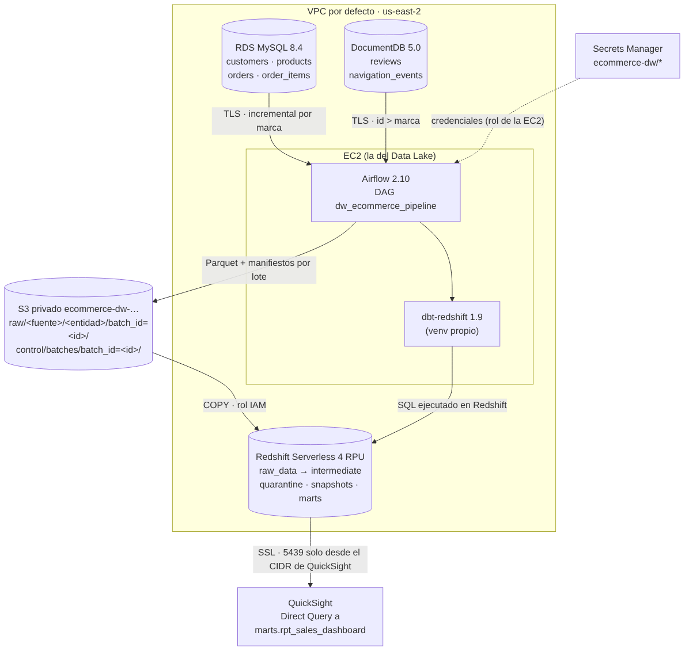

# Data Warehouse de e-commerce en AWS

Migración del proyecto local [DE-DW](https://github.com/smm-0216/DE-DW) (MySQL + MongoDB + DuckDB) a AWS:
**RDS MySQL + DocumentDB → S3 → Redshift Serverless → dbt → QuickSight**, orquestado por Airflow en
la misma EC2 del Data Lake. Toda la infraestructura se crea con Terraform.



| Capa | Dónde | Qué contiene |
|---|---|---|
| Fuentes | RDS MySQL 8.4 · DocumentDB 5.0 | Los mismos datos del curso (`generate_data`, `append_batch`, `simulate_changes`) |
| raw (archivo) | `s3://ecommerce-dw-<cuenta>-us-east-2/raw/<fuente>/<entidad>/batch_id=<id>/` | Parquet inmutable por lote |
| raw (tablas) | Redshift `raw_data.*` | Todos los lotes acumulados, con `_batch_id`, `_extracted_at`, `_source` |
| intermediate | Redshift `intermediate.*` (vistas) | staging (versión vigente por llave), reglas de calidad `*__qa` y `*__valid` |
| quarantine | Redshift `quarantine.*` | Rechazos con `rejection_reason` y `_batch_id` de origen |
| snapshots | Redshift `snapshots.*` | SCD tipo 2 de clientes y productos (`dbt snapshot`) |
| marts | Redshift `marts.*` | Modelo dimensional: 6 dimensiones, 3 hechos y la vista `rpt_sales_dashboard` |

## Estructura

```
dw/
├── dags/dw_ecommerce_pipeline.py   DAG de Airflow (14 tareas)
├── src/dw/
│   ├── settings.py, connections.py  variables de entorno y conexiones TLS (secretos en Secrets Manager)
│   ├── entities.py                  esquema único de las 6 entidades (Parquet y DDL de Redshift)
│   ├── batches.py                   batch_id, estado del lote y marcas de avance
│   ├── validate.py                  validación de parámetros y conexiones
│   ├── extract.py                   extracción full / incremental a S3 + manifiesto
│   ├── load.py                      COPY a Redshift en una transacción
│   ├── dbt_runner.py                ejecuta dbt y guarda run_results por lote
│   ├── reconcile.py                 conciliación fuente → raw → válidas → hecho
│   ├── scenarios.py                 ejecuta y documenta los 6 escenarios de la sección 3.5
│   ├── sources/                     generación de datos adaptada a RDS y DocumentDB
├── dbt/                            proyecto dbt adaptado a Redshift (+ sql/quicksight_validation.sql)
├── infra/terraform/                RDS, DocumentDB, Redshift Serverless, S3, IAM, Secrets Manager
├── infra/{sync_to_ec2,dw}.sh       copiar código a la EC2 · encender/apagar fuentes
│   ├── evidence.py                  genera las evidencias (Markdown) a partir de Airflow, S3 y Redshift
│   └── reset.py                     deja el DW en blanco para repetir los escenarios
├── infra/collect_evidence.sh       genera las evidencias en la EC2 y las descarga a evidencias/
├── evidencias/                     evidencias de funcionamiento (generadas) + captura del dashboard
├── docs/                           diagrama, guion de demostración y control de entrega
├── tests/                          pruebas unitarias (pytest + moto)
└── .env.example                    variables requeridas (sin secretos)
```

## Despliegue

Requisitos: el proyecto `datalake/` ya desplegado (su EC2 y su rol IAM se reutilizan) y las carpetas
`datalake/` y `dw/` una al lado de la otra.

**1. Infraestructura (en tu computador)**

```bash
cd dw/infra/terraform
cp terraform.tfvars.example terraform.tfvars
terraform init
terraform apply          # ~15 min: DocumentDB y RDS son lo más lento
```

Crea: RDS MySQL (privado, cifrado), DocumentDB (privado, cifrado, TLS), Redshift Serverless de 4 RPU con
límite diario de 16 RPU-hora, el bucket privado, el rol IAM que Redshift usa para el COPY, tres secretos
en Secrets Manager con contraseñas aleatorias y el permiso para que el rol de la EC2 los lea.

**2. Código e imagen (en tu computador)**

```bash
cd ../datalake && ./infra/ec2.sh start && cd ../dw
./infra/sync_to_ec2.sh --rebuild      # copia dw/ y datalake/, reconstruye la imagen (dbt, pymysql, certificado)
./infra/dw.sh env                     # imprime el contenido de dw/.env
```

**3. Variables (en la EC2, después de `./infra/ec2.sh ssh` desde datalake/)**

```bash
nano ~/dw/.env     # pega lo que imprimió ./infra/dw.sh env
cd ~/datalake && docker compose up -d --force-recreate
```

**4. Ejecución**

En la EC2 los 6 escenarios se ejecutan solos (cargan las fuentes, disparan el DAG y guardan la evidencia):

```bash
cd ~/datalake
docker compose exec airflow-scheduler python -m dw.scenarios            # ~25-35 min
docker compose exec airflow-scheduler python -m dw.scenarios --only 4   # uno solo
```

El DAG también se puede ejecutar a mano en Airflow (vista **Graph** → *Trigger DAG w/ config*):

| Parámetro | Valor | Efecto |
|---|---|---|
| `reprocess_batch_id` | vacío | lote nuevo |
| | `AAAAMMDDTHHMMSSZ` | reprocesa ese lote con sus archivos de S3, sin consultar las fuentes |
| `extraction_mode` | `auto` / `full` | incremental desde el último lote COMPLETE / todo |
| `simulate_failure` | `true` | falla la carga después del COPY (prueba de recuperación) |

Para cargar nuevos datos en las fuentes sin los escenarios:
`docker compose exec airflow-scheduler python -m dw.sources.append_batch --batch-id 3`.

**5. QuickSight** (manual, una sola vez): ver [Dashboard](#dashboard-de-quicksight).

**6. Eliminación de recursos (en tu computador)**

```bash
cd dw/infra/terraform && terraform destroy
```

Borra todo lo del DW, incluido el bucket (`force_destroy`) y los secretos (sin ventana de
recuperación, para poder volver a crearlos con el mismo nombre). En QuickSight borra el dashboard,
el análisis, el dataset y la fuente de datos, y cancela la suscripción si ya no la usas. Entre sesiones
de trabajo, `./infra/dw.sh stop` detiene MySQL y DocumentDB (Redshift Serverless no cobra cómputo sin
consultas).

## El DAG `dw_ecommerce_pipeline`

```
assign_batch → validate_connections → extract_mysql ┐
                                      extract_documentdb ┘→ load_redshift → dbt_deps → dbt_seed
→ dbt_run_intermediate → dbt_snapshot → dbt_run_marts → dbt_test → reconcile → mark_complete
                                    (cualquier fallo) → mark_failed
```

* Dependencias explícitas; `max_active_runs=1` (dos lotes a la vez competirían por la marca de avance).
* Reintentos acotados: 2 por tarea, cada 30 s (`assign_batch` y las de estado no reintentan).
* Cada línea de log empieza con `[batch_id=...][task=...]`; la tarea `mark_failed` registra qué tareas
  fallaron y el comando de reproceso.
* dbt corre en la EC2 (venv propio en la imagen); todo el SQL se ejecuta en Redshift.

## Cómo se identifica un lote y cuándo avanza la marca

* **Identificador:** `batch_id` = hora real UTC de inicio (`20261114T153012Z`). Se fija la primera vez
  en `control/airflow_runs/<run>.json`, así los reintentos de la misma ejecución usan el mismo lote.
* **Dónde aparece:** en la ruta de S3 (`batch_id=<id>/`), en la columna `_batch_id` de cada tabla
  `raw_data.*`, en `quarantine.*` (lote de origen del rechazo) y en los logs.
* **Registro del lote** en `s3://<bucket>/control/batches/batch_id=<id>/`:
  `extract_mysql.json` y `extract_documentdb.json` (fecha de extracción, modo, filas y marcas por
  entidad), `load.json`, `dbt_*.json` (resultado de cada nodo y prueba), `reconciliation.json` y
  `status.json` (`COMPLETE` o `FAILED`).
* **Marcas de avance:** pedidos, líneas, reseñas y eventos por `id > marca`; clientes y productos por
  `updated_at >= marca` (inclusivo para no perder cambios del mismo segundo; lo repetido se descarta en
  staging).
* **Cuándo avanza:** una extracción parte de las marcas del **último lote con `status=COMPLETE`**, y
  `status.json` se escribe solo en `mark_complete`, después de las pruebas y la conciliación. Si un lote
  falla queda `FAILED`, la marca no se mueve y el siguiente lote vuelve a extraer desde el último lote
  completo.
* **Recuperación:** se ejecuta el DAG con `reprocess_batch_id=<id fallido>`. La extracción no consulta
  las fuentes si el manifiesto existe; la carga hace `DELETE ... WHERE _batch_id=<id>` + `COPY` en una
  sola transacción; los hechos son incrementales `delete+insert` por llave y los snapshots solo crean
  versión si `updated_at` avanza. Por eso repetir un lote no duplica hechos ni versiones.

## Calidad y conciliación

* Pruebas dbt: `unique` y `not_null` en llaves, `relationships` de cada hecho con sus dimensiones,
  `accepted_values` y 6 pruebas de reglas de negocio (`dbt/tests/`), incluida la que compara la vista
  del tablero con `fct_sales`.
* Cuarentena: cada `int_*__qa` asigna un `rejection_reason`; `quarantine_*` guarda el registro completo
  con su `_batch_id`.
* Conciliación (`reconcile.py`) del indicador de ventas (conteo y `sum(subtotal)`):
  fuente MySQL = `raw_data` vigente; líneas válidas = `marts.fct_sales`; fuente − cuarentena = hecho.
  Si no cuadra, el lote queda `FAILED`.

## Dashboard de QuickSight

1. `terraform apply -var redshift_publicly_accessible=true` (abre el puerto 5439 solo al rango de
   QuickSight de us-east-2, `52.15.247.160/27`; Redshift exige SSL).
2. QuickSight (región us-east-2) → *Datasets* → *New* → *Redshift (manual connect)*: host
   `terraform output -raw redshift_endpoint`, puerto 5439, base `ecommerce`, usuario `dw_admin` y la
   contraseña del secreto `ecommerce-dw/redshift` (Secrets Manager → *Retrieve secret value*).
3. Tabla `marts.rpt_sales_dashboard`, modo **Direct query** (sin SPICE: el tablero siempre muestra el
   último lote procesado y no hay que refrescar nada).
4. Visuales: KPI `sum(subtotal)` (Ventas totales), barras `subtotal` por `sale_date` (mes) y
   `category`, y un control de filtro por `sales_channel`. Publicar como dashboard.
5. Validación: [`dbt/sql/quicksight_validation.sql`](dbt/sql/quicksight_validation.sql) da el último
   lote, el KPI sin filtro, el KPI con el mismo filtro del tablero y los valores de cada barra. En la EC2:
   `docker compose exec -T airflow-scheduler python -m dw.dashboard_check`.

## Decisiones técnicas y diferencias frente a la versión local

| Tema | Local (DE-DW) | AWS | Por qué |
|---|---|---|---|
| Motor analítico | DuckDB (archivo) | Redshift Serverless 4 RPU | Lo pide el reto; serverless no cobra cómputo sin consultas |
| Paso intermedio | lectura directa de las fuentes | Parquet en S3 por lote | Reprocesar sin consultar las fuentes; Parquet conserva tipos (decimal, timestamp) y `COPY ... FORMAT AS PARQUET` lo carga sin conversiones ni problemas de comillas o separadores |
| Carga | inserción desde Python | `COPY` con rol IAM | Carga paralela de Redshift; sin llaves de acceso |
| Esquema raw | `raw` | `raw_data` | `RAW` es palabra reservada en Redshift |
| raw | se reemplazaba | acumula lotes | Trazabilidad por `_batch_id`; staging toma la versión más reciente por llave (`latest_per_key`) |
| Carga incremental de hechos | `exists` correlacionado dentro de un `or` | `left join` con la tabla existente + `cross join` con el límite de la ventana | Redshift no soporta ese patrón de subconsulta correlacionada (falló en la primera ejecución incremental; corregido en `dbt/macros/incremental.sql`) |
| SQL | DuckDB | Redshift | `select * exclude` → `dbt_utils.star`; `is distinct from` → macro `null_safe_distinct`; `timezone()` → `convert_timezone`; `isodow` → macro `iso_day_of_week`; `json_extract_string` → `json_extract_path_text`; `datediff('day')` → `datediff(day)`; `using(...)` → `on` explícito (macros en `dbt/macros/redshift_compat.sql`) |
| Credenciales | `.env` | Secrets Manager + rol IAM de la EC2 | Sin secretos en archivos ni en el repositorio |
| Orquestación | Airflow local | Airflow en la EC2 del Data Lake + dbt en un venv de la imagen | Requisito: Airflow y dbt en la misma EC2 |

**MongoDB → DocumentDB**

* TLS obligatorio con el certificado de AWS (`global-bundle.pem`, incluido en la imagen).
* Conexión con `replicaSet=rs0`, `readPreference=secondaryPreferred` y `retryWrites=false`
  (DocumentDB no soporta escrituras reintentables).
* Validador `$jsonSchema`: DocumentDB soporta un subconjunto; si rechaza alguna palabra clave, el
  script crea la colección sin validador, lo registra y la calidad se sigue controlando en dbt.
* Las fechas se guardan en UTC; se convierten a la hora de negocio (`America/Bogota`) en dbt.
* El cluster es privado (solo accesible desde la EC2), a diferencia del contenedor local.

## Costos estimados (us-east-2, verificados el 13-nov-2026)

| Recurso | Precio | Uso del taller (~2 días, ~10 h encendido) |
|---|---|---|
| Redshift Serverless | 0,375 USD por RPU-hora, mínimo 60 s por consulta; 4 RPU = 1,50 USD/h activa | ~10 ejecuciones del DAG + consultas: 2–5 USD. Tope: 16 RPU-h/día ≈ 6 USD/día. Cuentas nuevas: crédito de 300 USD por 90 días |
| DocumentDB db.t3.medium | ~0,08–0,11 USD/h (+ I/O 0,20 USD/millón) | ~1–2 USD. Prueba gratuita de 750 h/mes por 30 días si la cuenta nunca lo usó |
| RDS MySQL db.t4g.micro | ~12 USD/mes (~0,016 USD/h) + 20 GB | < 0,50 USD |
| Secrets Manager | 0,40 USD por secreto al mes (3) | < 0,10 USD (prorrateado) |
| S3 | centavos | < 0,05 USD |
| QuickSight | Author 24 USD/mes | hasta 24 USD si no tienes prueba; **no** crear usuarios Pro ni activar Q&A (cargo de 250 USD/mes por cuenta) |
| EC2 del Data Lake | ya existente (t3.large) | igual que en el Data Lake |

Total esperado sin QuickSight: **menos de 10 USD** si se ejecuta `./infra/dw.sh stop` entre sesiones y
`terraform destroy` al terminar. Los precios de terceros (DocumentDB, RDS) se tomaron de rastreadores de
precios; confírmalos en la calculadora de AWS antes de `terraform apply`.

## Controles de seguridad

* RDS, DocumentDB y Redshift en la VPC; MySQL y DocumentDB **no** son públicos y solo aceptan
  conexiones del security group de la EC2.
* Redshift: privado por defecto; para QuickSight se abre únicamente al rango oficial de QuickSight y
  con `require_ssl=true`.
* Cifrado en reposo (RDS, DocumentDB, S3 SSE, Redshift) y en tránsito (TLS en las tres conexiones;
  el bucket rechaza peticiones sin TLS).
* Bucket con *Block Public Access* y propietario forzado.
* Contraseñas aleatorias generadas por Terraform y guardadas solo en Secrets Manager; la EC2 las lee con
  su rol IAM, dbt las recibe como variables de entorno del proceso.
* Mínimo privilegio: el rol de Redshift solo lee `raw/` del bucket; el rol de la EC2 solo lee los tres
  secretos `ecommerce-dw/*` y el bucket del DW.
* Sin secretos en el repositorio: `.env`, `*.tfvars`, `*.tfstate` y `*.pem` están en `.gitignore`.
  El estado de Terraform contiene las contraseñas: no se sube.

## Evidencias

`evidencias/` contiene el resultado verificado en AWS (índice en [evidencias/README.md](evidencias/README.md)):
los 6 escenarios en OK, 95 pruebas de dbt en verde, la conciliación de cada lote y la validación del
tablero (KPI 7.420.730,58 = consulta SQL). Para regenerarlas (en tu computador, con la EC2 encendida):

```bash
./infra/collect_evidence.sh
```

Para repetir los escenarios desde cero (en la EC2):

```bash
cd ~/datalake
docker compose exec -T airflow-scheduler python -m dw.reset --yes
docker compose exec -T airflow-scheduler python -m dw.scenarios
```

Guion de la demostración: [docs/DEMOSTRACION.md](docs/DEMOSTRACION.md) · Control de entrega:
[docs/ENTREGA.md](docs/ENTREGA.md).

**Nota sobre los lotes de origen en cuarentena:** clientes y productos se extraen con
`updated_at >= marca`, así que los clientes defectuosos (cuyo `updated_at` es la marca) vuelven a llegar en
lotes incrementales; staging se queda con la versión más reciente y la cuarentena muestra ese lote.

## Pruebas locales

```bash
conda activate datalake
pip install pymysql pymongo redshift-connector faker moto pytest
python -m pytest -q tests        # 23 pruebas: lotes, marcas de avance, extracción, carga, esquema y evidencias
```

Fuentes de precios: [AWS DocumentDB pricing](https://aws.amazon.com/documentdb/pricing/),
[AWS QuickSight pricing](https://aws.amazon.com/quicksight/pricing/),
[Redshift Serverless (CloudBurn)](https://cloudburn.io/blog/amazon-redshift-pricing),
[RDS db.t4g.micro (Bytebase)](https://www.bytebase.com/dbcost/rds/instance/db.t4g.micro/).
